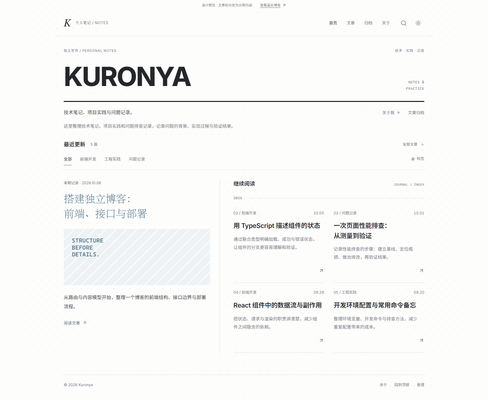
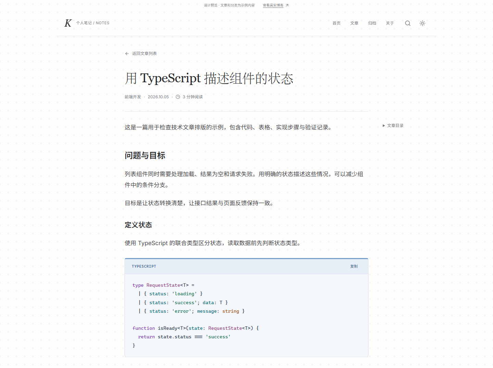
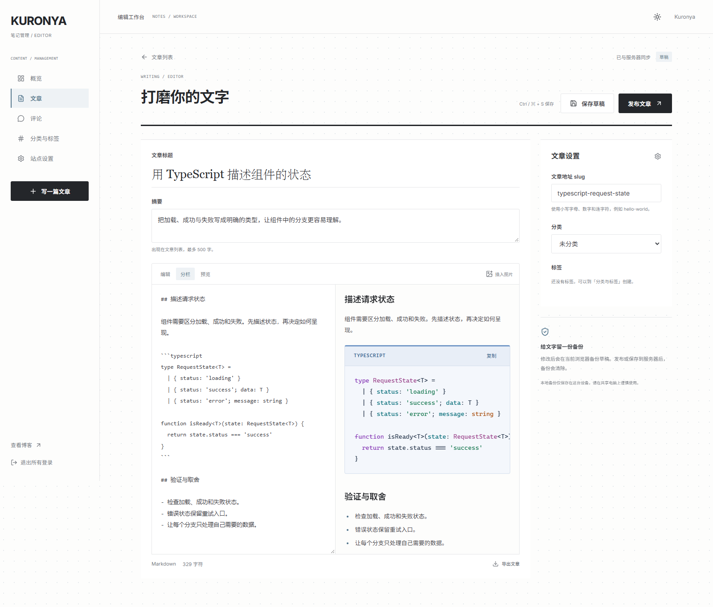

# Kuronya 的个人博客

一个用于记录技术笔记、项目实践与问题排查的个人博客，包含读者前台和内容管理后台。

前台采用杂志网格排版：近白底色、炭灰标题、柔蓝强调与淡点阵。文章使用独立阅读页，支持代码高亮与复制、图片放大、文章目录，以及浅色、深色和跟随系统主题。

[界面预览](#界面预览) · [本地运行](#本地运行) · [服务器部署](#服务器部署) · [接口说明](#接口说明) · [测试与维护](#测试与维护)

## 界面预览

截图使用预览文章与隔离测试数据。

### 首页

主文章、分类筛选和按年份组织的文章分栏。



<details>
<summary>查看文章阅读页</summary>

衬线标题、章节目录与代码块。代码区有独立工具栏、语言标签和复制按钮，深浅主题分别配色。



</details>

<details>
<summary>查看后台写作页面</summary>

Markdown 分栏编辑与实时预览，旁边可设置文章地址、分类和标签。



</details>

## 功能

- **阅读与检索**：文章分页、全文搜索、分类与标签筛选、年份归档、个人介绍。
- **Markdown 阅读**：按需加载代码高亮、代码复制、章节定位、引用和嵌套列表、宽表格滚动、图片说明与放大。
- **写作与发布**：草稿 / 发布、摘要、图片上传、Markdown 导出、Ctrl / ⌘ + S 保存、本地草稿备份和离开提醒。
- **评论管理**：访客评论、后台审核 / 撤回 / 删除、全站评论开关；通过审核后公开展示。
- **站点管理**：博客名称、昵称、介绍、分类标签管理、管理员密码修改与退出所有登录。
- **更新保护**：文章版本检查，出现并发修改时保留当前文字并提示合并。

管理员账号通过服务器命令创建，没有默认账号密码或公开注册入口。正式文章与上传图片均由后端持久化。

## 技术栈

| 部分 | 技术 |
| --- | --- |
| 前端 | React、TypeScript、Vite、React Router |
| Markdown | markdown-it、DOMPurify、highlight.js |
| 后端 | FastAPI、SQLAlchemy、SQLite |
| 认证 | Argon2 密码哈希、JWT |
| 部署 | Docker Compose、Nginx |

Docker 镜像使用 Python 3.13 和 Node.js 24。本地开发建议使用这两个版本；Python 3.14 也已用于本地验证。前端字体自托管，字体许可证随项目保留。

## 本地运行

以下为 Windows PowerShell 流程，需要先安装 Python、Node.js 和 Git。

### 1. 获取项目并安装依赖

```powershell
git clone https://github.com/SatakaGintoki/my_blog.git
cd my_blog
python -m venv .venv
.\.venv\Scripts\python.exe -m pip install -r requirements.txt
npm ci --prefix frontend
```

### 2. 初始化配置并创建管理员

```powershell
.\.venv\Scripts\python.exe scripts/init_local.py
.\.venv\Scripts\python.exe -m app.cli create-admin --username Kuronya
```

初始化脚本仅在 `.env` 不存在时生成文件和随机 JWT 密钥，不覆盖已有配置。创建管理员时交互输入两次密码，长度为 12–256 个字符。

### 3. 启动前后端

```powershell
.\start.ps1
```

这个脚本同时启动 API 和 Vite；Ctrl + C 停止开发服务。

| 入口 | 地址 |
| --- | --- |
| 正式博客 | <http://localhost:5173> |
| 只读设计预览 | <http://localhost:5173/preview> |
| 管理后台 | <http://localhost:5173/admin> |
| API 健康检查 | <http://127.0.0.1:8000/health> |

新数据库没有正式文章。登录后可在「站点设置」填写个人介绍，在「文章」中新建并发布内容。预览文章只用于开发，不写入正式数据库；默认生产构建关闭 `/preview`。

开发前端通过同源代理访问 API，默认不需要修改 CORS。若自行拆分前后端域名，`CORS_ORIGINS` 需填写 JSON 数组，例如 `["https://blog.example.com"]`，并重启后端。

Windows 虚拟环境解释器无法启动时，可使用同版本的已安装 Python。具体方法、前端开发与个人介绍填写说明见 [前端文档](frontend/README.md)。

## 服务器部署

准备一台安装了 Docker 和 Docker Compose 插件的 Linux 服务器。获取代码需要 Git，下面的密钥生成命令需要 Python 3。

### 1. 获取代码并填写环境变量

在有写入权限的目录中执行：

```bash
git clone https://github.com/SatakaGintoki/my_blog.git
cd my_blog
cp .env.example .env
python3 -c 'import secrets; print(secrets.token_urlsafe(48))'
nano .env
```

把生成的密钥填写到 `.env` 的 `JWT_SECRET=` 后。`.env`、数据库和上传目录不纳入 Git。Docker Compose 会将数据库与上传路径设为容器内的 `/app/data`，并保存到 `blog_data` 命名卷。

### 2. 启动服务并创建管理员

```bash
docker compose up -d --build
docker compose ps
curl http://127.0.0.1:8000/health
docker compose exec blog python -m app.cli create-admin --username Kuronya
```

健康检查正常时返回 `{"status":"ok"}`。网站绑定服务器的 `127.0.0.1:8080`，API 绑定 `127.0.0.1:8000`；接入域名前不会直接开放这两个端口到公网。

### 3. 接入域名与 HTTPS

参考 [Nginx 配置示例](deploy/nginx.conf.example)，将 `blog.example.com` 替换为自己的域名。网站请求转发到 8080，登录接口转发到 8000，并设置相应限流。配置完成后执行 `nginx -t` 检查，再重载 Nginx。

示例提供 HTTP 起始配置，需要另行配置 HTTPS 证书与 HTTP → HTTPS 跳转。若域名前面使用 CDN，应按其可信 IP 范围配置 Nginx `real_ip`。

当前版本已通过本地构建、API 与浏览器检查；Docker / Nginx 容器运行仍需在实际服务器验收。上线后应检查首页、子页面直接访问、登录、发布、上传、评论审核，以及重启后文章和图片是否保留。

前端生产构建默认关闭示例预览。后端镜像仅安装 `requirements-prod.txt` 中的运行依赖；截图、开发依赖和本地数据不进入生产镜像。资源与缓存说明见 [部署资源检查](deploy/RESOURCE-AUDIT.md)。

## 接口说明

API 前缀为 `/api/v1`。管理接口使用 `Authorization: Bearer <access_token>`；健康检查位于 `/health`，OpenAPI JSON 位于 `/openapi.json`。可设置 `OPENAPI_ENABLED=false` 关闭 OpenAPI JSON。

<details>
<summary>接口列表与文章请求示例</summary>

| 方法 | 路径（省略 `/api/v1`） | 用途 |
| --- | --- | --- |
| POST | `/auth/login` | 用户名与密码登录 |
| GET | `/auth/me` | 当前管理员 |
| POST | `/auth/logout` | 退出所有设备 |
| PUT | `/auth/password` | 修改密码 |
| GET | `/posts`、`/posts/{slug}` | 已发布文章列表 / 正文 |
| GET / POST | `/admin/posts` | 管理列表 / 创建文章 |
| GET / PUT / DELETE | `/admin/posts/{id}` | 获取 / 更新 / 删除文章 |
| GET | `/categories`、`/tags` | 分类与标签列表 |
| POST | `/admin/categories`、`/admin/tags` | 创建分类与标签 |
| PUT / DELETE | `/admin/categories/{id}`、`/admin/tags/{id}` | 更新 / 删除分类与标签 |
| GET / POST | `/posts/{slug}/comments` | 已审核评论 / 提交待审核评论 |
| GET | `/admin/comments` | 审核列表 |
| PATCH / DELETE | `/admin/comments/{id}` | 审核 / 删除评论 |
| GET | `/site` | 读取站点信息 |
| PUT | `/admin/site` | 更新站点信息 |
| POST | `/admin/preview` | 安全的 Markdown HTML 预览 |
| POST | `/admin/uploads` | multipart `file` 字段上传图片 |

文章请求示例：

```json
{
  "title": "我的第一篇博客",
  "slug": "hello-world",
  "summary": "开始记录技术笔记与项目实践",
  "content": "## 你好，世界\n\n这是 Markdown 正文。",
  "status": "published",
  "category_id": null,
  "tag_ids": []
}
```

文章列表参数包括 `page`、`page_size`、`q`、`category_id`、`tag_id`，返回 `{items,total,page,page_size}`。评论使用 `offset` / `limit` 分页，后台还可使用 `approved` 筛选。

`status` 仅支持 `draft` / `published`。slug 使用小写字母、数字和连字符。`PUT` 为全量更新，应提交全部必填字段。文章更新可附带 `expected_updated_at`；服务器版本已变化时返回 409。

评论审核请求为 `{"approved": true}`。重复名称或 slug 返回 409，参数不合法返回 422。修改密码和退出登录会使该管理员的旧令牌失效。

正文和个人介绍保存为原始 Markdown，评论保存为纯文本。原始 HTML 和危险链接在 Markdown 渲染时被禁用或清理。上传支持 JPEG / PNG / WebP，最大 5 MB、2000 万像素，后端重编码为 WebP。

</details>

## 测试与维护

后端测试：

```powershell
.\.venv\Scripts\python.exe -m pytest -q
```

前端检查：

```powershell
cd frontend
npm run build
npm run audit:dist
npm run lint
npm run test:e2e
```

测试使用临时数据库、测试账号和密钥，不操作正式博客数据。浏览器测试使用端口 8001 / 5174，覆盖阅读、Markdown 交互、发布、上传、评论审核、草稿恢复、版本冲突与站点设置。浏览器安装和解释器配置见 [前端文档](frontend/README.md#检查)。

日志与账号维护：

```bash
docker compose logs -f --tail=100 blog
docker compose exec blog python -m app.cli reset-password --username Kuronya
```

### 数据备份与恢复

普通重建或重启会保留 `blog_data` 命名卷。**不要执行 `docker compose down -v`，它会删除数据卷。**

<details>
<summary>备份与恢复命令</summary>

运行中的数据库使用 SQLite backup API 获取一致性备份，再复制到宿主机：

```bash
docker compose exec blog python -c 'import sqlite3; source=sqlite3.connect("/app/data/blog.db"); target=sqlite3.connect("/tmp/blog-backup.db"); source.backup(target); target.close(); source.close()'
docker compose cp blog:/tmp/blog-backup.db ./blog-backup.db
# 图片单独备份；备份期间暂停写作和上传。
docker compose cp blog:/app/data/uploads ./uploads-backup
```

恢复前先停止后端，替换数据库并移除旧 WAL 文件，再启动服务：

```bash
docker compose stop blog
docker compose run --rm --no-deps -v "$PWD/blog-backup.db:/backup/blog.db:ro" blog python -c 'import shutil; from pathlib import Path; root=Path("/app/data"); [(root/name).unlink(missing_ok=True) for name in ("blog.db-wal", "blog.db-shm")]; shutil.copyfile("/backup/blog.db", root/"blog.db")'
docker compose up -d
```

需要恢复图片时，可执行 `docker compose cp ./uploads-backup/. blog:/app/data/uploads`。容器目录属于 UID 10001；手动复制后若出现上传权限错误，应在停止服务期间修复所有权。

备份包含文章、评论和管理员密码哈希，应妥善保存，并同步保管 `.env`。更换 JWT 密钥会让已签发令牌失效。上传目录中的图片通过公开 URL 提供给读者。

</details>

### 当前范围

当前为客户端渲染页面；没有服务端渲染、邮件通知、文章历史版本或图片删除功能。应用默认单 worker，限流存于进程内；扩展多实例时需使用统一限流和相应的数据方案。启动时创建初始表，未来修改数据库字段时需要显式迁移并先备份。

更多前端与视觉说明见 [前端文档](frontend/README.md) 和 [设计说明](frontend/DESIGN.md)。
